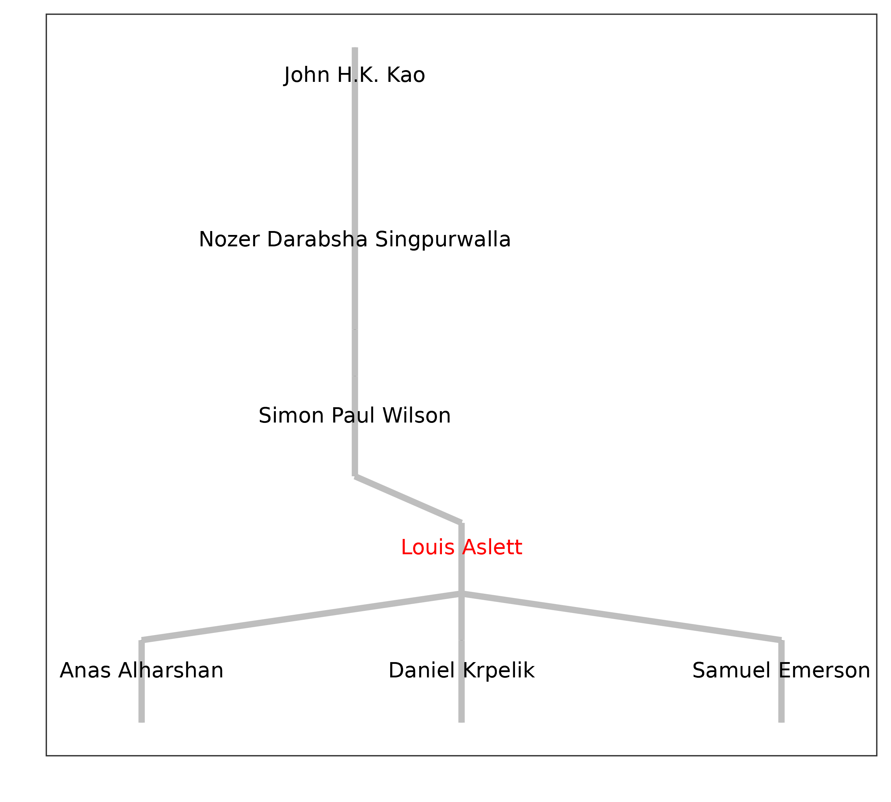
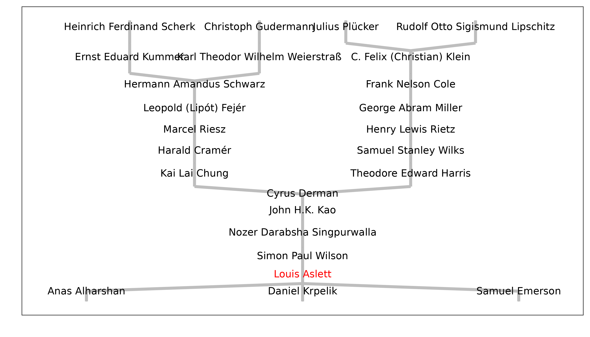
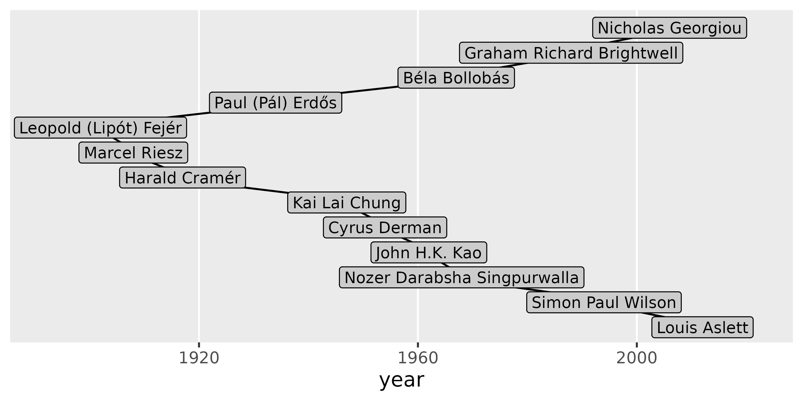
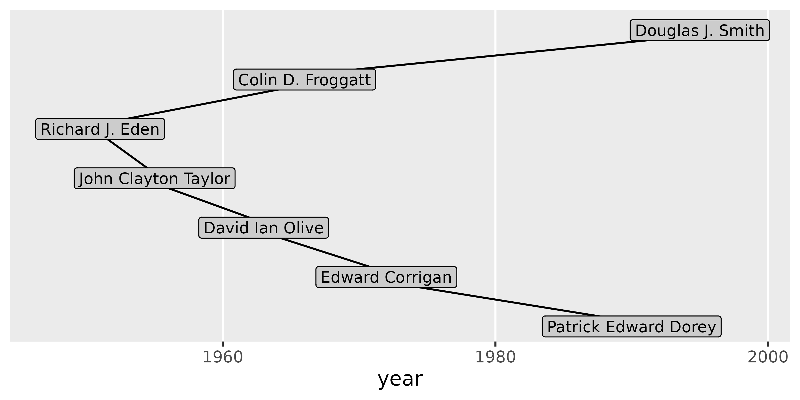
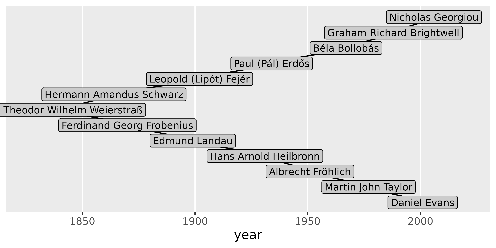
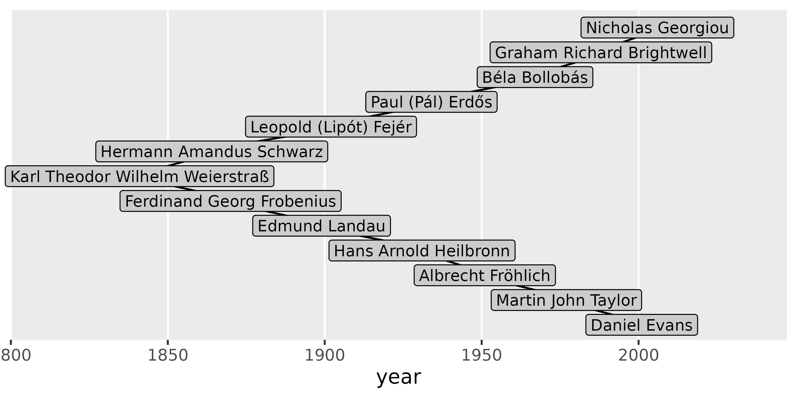

# Getting Started

The Mathematics Genealogy Project (MGP), available at
<https://mathgenealogy.org/>, is an online platform dedicated to
compiling the academic ancestry of mathematicians. Its mission is to
create a comprehensive resource that tracks the intellectual lineage of
individuals in the field of mathematics (broadly interpreted) by
collecting and organising information about their PhD degrees, advisors,
and students. The project provides access to this genealogical data
through their website, enabling researchers and enthusiasts to explore
the connections and relationships within the mathematics community. The
MGP plays a vital role in preserving the history and development of the
discipline. We owe a debt of gratitude to Dr Harry Coonce, who founded
the project in 1997 ([Jackson, 2007](#refs)), following which the
database has [steadily
grown](https://www.mathgenealogy.org/growth_image.php) to reach well
over 300,000 entries by late 2024.

This package is designed to enable downloading and plotting the
genealogical tree data from the MGP in R, expanding on the functionality
that is available through the website.

## Getting started

We begin, as always, by loading the package:

``` r
library("maths.genealogy")
```

To utilise the main data-related functions within the package —
specifically,
[`search_id()`](https://genealogy.louisaslett.com/reference/search_id.md)
and
[`get_genealogy()`](https://genealogy.louisaslett.com/reference/get_genealogy.md)
— an active internet connection is required.

Every mathematician listed in the Mathematics Genealogy Project (MGP) is
assigned a unique ID. The first task is to locate the ID for the
mathematician(s) you wish to investigate. There are at least two methods
to accomplish this. The first option is to visit the MGP website’s
search page at <https://www.mathgenealogy.org/search.php> and complete
the search fields. After locating the desired mathematician and
navigating to their data page, you will notice that the URL in your
browser’s address bar follows the format
`https://www.mathgenealogy.org/id.php?id=171971`, where the numbers at
the end represent the ID (in this instance, 171971 is the ID for the
author of this package).

Alternatively, this package offers a second option that allows you to
remain within your R session. By using the function
[`search_id()`](https://genealogy.louisaslett.com/reference/search_id.md),
you can specify the same search parameters and obtain a data frame
summarising the results, including the essential ID for subsequent
steps. Below is the output from a search using the family name of the
author of this package:

``` r
search_id("aslett")
#>       id             name                        university year
#> 1 171971    Aslett, Louis           Trinity College, Dublin 2012
#> 2 164179    Haslett, John                                       
#> 3 164818 Haslett, Stephen Victoria University of Wellington 1986
#> 4  57304 Laslett, Geofrey    Australian National University 1975
```

As can be seen, the search performs partial matches and is case
insensitive.

If needed, some simple regular expression constructs are also supported.
For instance, if you happened to know the author’s family name but only
that their first initial is “L”, you can narrow down the search by
requiring a full match of the family name and a match on the first
letter of the given name:

``` r
search_id("^aslett$", "^l")
#>       id          name              university year
#> 1 171971 Aslett, Louis Trinity College, Dublin 2012
```

You will likely be able to find the required mathematician without using
regular expressions, but if you would like a beginner’s tutorial on how
to use them, refer to [Chapter 15 of R for Data
Science](https://r4ds.hadley.nz/regexps.html) (Wickham et al., 2023).

## Fetching genealogical data

With the ID `171971` from the search, you can now retrieve the author’s
genealogical tree:

``` r
g <- get_genealogy(171971)
#> ✔ Connecting to geneagrapher-core WebSocket server [541ms]
#> ✔ Sending query [20ms]
#> ✔ 🎓 Full genealogy retrieved [1.5s]                   
```

When passing only the ID, the function searches the entire tree both
“upwards”, fetching all ancestors, as well as “downwards”, fetching all
descendants. Note that for mathematicians in modern times, there can be
a considerable number of ancestors, and for historical mathematicians,
the descendant trees may be even larger. For these reasons,
[`get_genealogy()`](https://genealogy.louisaslett.com/reference/get_genealogy.md)
allows you to disable these functions by using the arguments `ancestors`
and `descendants` and passing `FALSE`.

## Plotting the genealogical tree

There are currently two ways to plot the genealogical tree. The first
uses Graphviz (Ellson et al., 2004) via the `DiagrammeR` package
(Iannone and Roy, 2024), while the second employs the `ggenealogy`
package (Rutter et al., 2019). Neither of these packages is specified as
a hard dependency, but you will be prompted to install them if you
attempt to use the relevant plotting function without the requisite
packages.

Graphviz typically produces the best full-tree view and can be generated
using
[`plot_grviz()`](https://genealogy.louisaslett.com/reference/plot_grviz.md).
Continuing with the previous example, this can be accomplished by:

``` r
plot_grviz(g)
```

If you are viewing this vignette in a browser, you can zoom in and out
using your mouse scroll wheel or trackpad. Alternatively, you can zoom
in by double-clicking and zoom out by holding the shift key while
double-clicking. You can pan around by dragging the plot.

To render this to a PDF file instead of viewing it interactively, simply
provide a file name as the second argument:

``` r
plot_grviz(g, "aslett-tree.pdf")
```

As an alternative, `ggenealogy` is excellent for plotting ‘local’
genealogy, showing a limited number of ancestral/descendant generations,
as follows:

``` r
plot_gg(g)
#> Warning: `qplot()` was deprecated in ggplot2 3.4.0.
#> ℹ The deprecated feature was likely used in the ggenealogy package.
#>   Please report the issue to the authors.
#> This warning is displayed once every 8 hours.
#> Call `lifecycle::last_lifecycle_warnings()` to see where this warning was
#> generated.
#> Warning: Using `size` aesthetic for lines was deprecated in ggplot2 3.4.0.
#> ℹ Please use `linewidth` instead.
#> ℹ The deprecated feature was likely used in the maths.genealogy package.
#>   Please report the issue at
#>   <https://github.com/louisaslett/maths.genealogy/issues>.
#> This warning is displayed once every 8 hours.
#> Call `lifecycle::last_lifecycle_warnings()` to see where this warning was
#> generated.
```



You can also control the number of ancestral and descendant generations
displayed using `max_anc` and `max_des`:

``` r
plot_gg(g, max_anc = 11)
```



Care will need to be taken with the sizing of the plot to ensure it is
readable: unlike the Graphviz output this relies on R’s plot scaling.

## More than one mathematician

Note that the genealogical tree can be built using more than one
mathematician’s ID when calling
[`get_genealogy()`](https://genealogy.louisaslett.com/reference/get_genealogy.md).
This will result in each ID being used as a starting point from which to
traverse the tree through ancestors and descendants. The genealogical
tree can be constructed using multiple mathematicians’ IDs when calling
[`get_genealogy()`](https://genealogy.louisaslett.com/reference/get_genealogy.md).
This will use each ID as a starting point for traversing the tree
through ancestors and descendants, including all results in a single
genealogical tree.

The inspiration for this package arose from a discussion over drinks
between the package author and some colleagues at Durham University.
This is as good a way as any to select the next example, which plots the
joint genealogical tree built by using those present as starting IDs!

``` r
g <- get_genealogy(c(171971, 108465, 175763, 191788, 169213))
#> ✔ Connecting to geneagrapher-core WebSocket server [558ms]
#> ✔ Sending query [33ms]
#> ✔ 🎓 Full genealogy retrieved [8.5s]
```

Now using the
[`plot_grviz()`](https://genealogy.louisaslett.com/reference/plot_grviz.md)
function will plot the *joint* genealogy of the mathematicians specified
in the call to
[`get_genealogy()`](https://genealogy.louisaslett.com/reference/get_genealogy.md).

``` r
plot_grviz(g)
```

It can be difficult from this plot to identify something of common
interest when plotting multiple mathematicians: the nearest common
ancestor and shortest path between them. This can be achieved by using
[`plot_gg_path()`](https://genealogy.louisaslett.com/reference/plot_gg_path.md).
By default, it will plot the shortest path between the first two
mathematicians that were specified in the call to
[`get_genealogy()`](https://genealogy.louisaslett.com/reference/get_genealogy.md)
which built the genealogical tree, using the x-axis to indicate the year
of graduation.

``` r
plot_gg_path(g)
```



To plot between different mathematicians, one can use the `id1` and
`id2` arguments.

``` r
plot_gg_path(g, id1 = 175763, id2 = 191788)
```



Each id defaults to the first and second mathematicians, so if only one
is specified, it overrides that entry only.

``` r
plot_gg_path(g, id1 = 169213)
```



The above plot includes a common ancestor with a particularly long name
(Weierstraß). Issues like this can be resolved by increasing the value
of the `expand` argument above the default, which is 0.15.

``` r
plot_gg_path(g, id1 = 169213, expand = 0.25)
```



## Other software

Development of this software was inspired by the `geneagrapher` Python
package (<https://github.com/davidalber/geneagrapher>) and makes use of
the WebSocket server running `geneagrapher-core`
(<https://github.com/davidalber/geneagrapher-core>), which was designed
to cache queries to the MGP to reduce the load on their main site.
Permission to query the caching endpoint from this R package was
[requested and granted in
advance](https://github.com/davidalber/geneagrapher/issues/38).

## References

Ellson, J., Gansner, E.R., Koutsofios, E., North, S.C. and Woodhull, G.
(2004). “Graphviz and Dynagraph — Static and Dynamic Graph Drawing
Tools”. In: Jünger, M., Mutzel, P. (eds) *Graph Drawing Software,
Mathematics and Visualization*, 127-148.
[10.1007/978-3-642-18638-7_6](https://doi.org/10.1007/978-3-642-18638-7_6).

Iannone, R. and Roy, O. (2024). *DiagrammeR: Graph/Network
Visualization*. R package,
<https://CRAN.R-project.org/package=DiagrammeR>.

Jackson, A. (2007). “A Labor of Love: The Mathematics Genealogy
Project”, *Notices of the AMS*, **54**(8), 1002-1003.
<https://www.ams.org/notices/200708/tx070801002p.pdf>

Rutter, L., VanderPlas, S., Cook, D. and Graham, M.A. (2019).
“ggenealogy: An R Package for Visualizing Genealogical Data”, *Journal
of Statistical Software*, **89**(13), 1-31.
[doi:10.18637/jss.v089.i13](https://doi.org/10.18637/jss.v089.i13).

Wickham, H., Çetinkaya-Rundel, M. and Grolemund, G. (2024). *R for Data
Science: Import, Tidy, Transform, Visualize, and Model Data*. 2nd
Edition. O’Reilly Media. ISBN: 978-1492097402.
